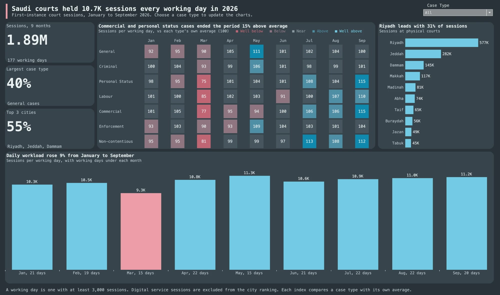

# Saudi Court Sessions

Saudi courts held 10.7K sessions every working day from January to September 2026. This project uses SQL to measure court workload across 1.89 million sessions, separating real changes in daily activity from months with fewer working days.

## Key results

- **+9%** more sessions per working day in September than in January.
- **55%** of sessions at physical courts took place in Riyadh, Jeddah and Dammam.
- **-12%** fall in daily sessions from February to March, against a 30% fall in the monthly total.

**Recommendation:** plan court capacity on sessions per working day rather than monthly totals, which swing with the number of working days. Commercial and personal status cases ended September 15% above their average, so start with these two when reviewing capacity. The data has no capacity figures, such as judges or courtrooms.

## Data

Source: monthly court session files for January to September 2026 from the [Saudi Open Data Platform](https://open.data.gov.sa). The original files are not stored here because of their size. `python/court_load.py` downloads them and loads them into SQLite.

## Steps

1. `python3 python/court_load.py raw courts.db` downloads the nine months and builds the SQLite database.
2. `sql/analysis.sql` holds the data quality checks and analysis, using joins, CTEs, `LAG`, `RANK`, running totals and `PARTITION BY`.
3. `python3 sql/run_analysis.py courts.db sql/analysis.sql output` runs each `@export` block and writes it to `output/`.
4. `dashboard/court_sessions_dashboard.twb` is the Tableau dashboard. When Tableau asks for the data, point it to `output/tableau_data.csv`.

## Tools

SQL, Tableau
